<p align="center">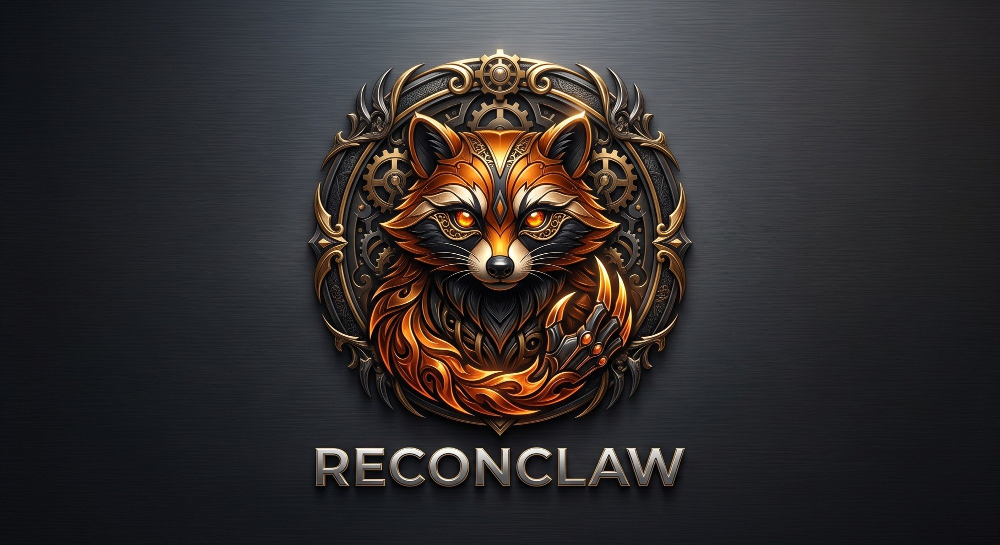</p>

<h1 align="center">🏆 ReconClaw: TEKNOFEST ve TÜBİTAK Proje Dosyası</h1>

<p align="center"><b>Yapay Zekâ Destekli, Etik Tasarımlı Sürekli Saldırı Yüzeyi İzleme ve Risk Analiz Platformu</b></p>

<p align="center">
<a href="https://reconclaw.com.tr"></a>


<br>


</p>

> [!NOTE]
> Bu dosya başvuru formlarına ve jüri sunumuna uyarlanabilecek **proje anlatımıdır**. Kategori, takım, danışman, rapor şablonu ve sayfa sınırlarını başvurduğunuz programın **güncel şartnamesinden** kontrol edin. **"Önerilen deney"** olarak geçen ölçümler henüz yapılmamıştır; sonuçları kendi laboratuvarınızda ölçüp ilgili tabloya ekleyin. Belgedeki tüm teknik rakamlar (test sayısı, imza ve teknik sayıları) kodun mevcut haliyle birebir uyumludur.

---

## 📑 İçindekiler

| | | |
|---|---|---|
| [1. Bir bakışta](#1--bir-bakışta) | [8. Etik ve güvenlik tasarımı](#8-️-etik-ve-güvenlik-tasarımı) | [15. Bütçe şablonu](#15--bütçe-şablonu) |
| [2. Problem](#2--problem) | [9. Doğrulama ve testler](#9--doğrulama-ve-testler) | [16. Jüri demo senaryosu](#16-️-jüri-demo-senaryosu-8-dakika) |
| [3. Çözüm ve kullanıcı yolculuğu](#3--çözüm-ve-kullanıcı-yolculuğu) | [10. Mevcut çözümlerle karşılaştırma](#10-️-mevcut-çözümlerle-karşılaştırma) | [17. Jüri soruları](#17--jüriden-beklenebilecek-sorular) |
| [4. Özgün değer](#4--özgün-değer-ve-yenilikçi-yönler) | [11. Yaygın etki ve yerlilik](#11--yaygın-etki-ve-yerlilik) | [18. Takım](#18--takım) |
| [5. Mimari](#5-️-mimari) | [12. Sürdürülebilirlik](#12--sürdürülebilirlik-ve-iş-modeli) | [19. Kaynakça](#19--kaynakça) |
| [6. Ekran görüntüleri](#6-️-ekran-görüntüleri) | [13. Yol haritası](#13-️-yol-haritası-v100--v110) | [20. English summary](#20--english-summary) |
| [7. Yöntem](#7--yöntem) | [14. İş-zaman planı ve risk](#14--iş-zaman-planı-ve-risk-yönetimi) | |

---

## 1. 🦝 Bir bakışta

<table>
<tr>
<td width="33%" align="center" valign="top">

### 🔎 Keşfeder
Bir alan adının internete açık servislerini asenkron tarar, sürümleri tespit eder, bilinen zafiyet imzalarıyla eşleştirir.

</td>
<td width="33%" align="center" valign="top">

### 🧠 Yorumlar
Bulguları **0–100 risk skoru**, **A+…F notu**, **MITRE ATT&CK** saldırı zinciri ve **ISO 27001 / KVKK** değerlendirmesine çevirir.

</td>
<td width="33%" align="center" valign="top">

### 📡 İzler
Hedefi sürekli izler; yeni açılan port veya sürüm değişikliğinde alarm ve bildirim gönderir.

</td>
</tr>
</table>

| | |
|---|---|
| **Proje adı** | ReconClaw: Yapay Zekâ Destekli Sürekli Saldırı Yüzeyi İzleme ve Risk Analiz Platformu |
| **Alan** | Siber güvenlik · Ağ güvenliği · Yazılım mühendisliği |
| **Ürün türü** | Web tabanlı, çok kullanıcılı, açık kaynak kodlu platform (SaaS olarak da yayında) |
| **Canlı adres** | [reconclaw.com.tr](https://reconclaw.com.tr) |
| **Kaynak kod** | [github.com/Pireburak/ReconClaw](https://github.com/Pireburak/ReconClaw) |
| **Sürüm** | v9.1 Cortex |
| **Teknolojiler** | Python 3, FastAPI, asyncio, SQLite, Claude API (`anthropic` SDK), vanilla JavaScript, Docker, Caddy, Cloudflare, GitHub Actions |
| **Doğrulama** | 159 otomatik test (pytest), her değişiklikte çalışır |
| **Kural tabanı** | 27 yaygın port, 5 CVE sürüm imzası, 14 taktikte 20 MITRE ATT&CK tekniği, 8 ISO/IEC 27001:2022 Ek A kontrolü ve KVKK m.12 |

---

## 2. 🎯 Problem

> **"Bir kurumun en tehlikeli açığı, varlığından haberdar olmadığı açıktır."**

| # | Sorun | Sonucu |
|:-:|-------|--------|
| 1 | **Görünürlük eksikliği:** Kurumlar hangi servislerinin internetten erişilebilir olduğunu çoğu zaman bilmez. | Unutulmuş test sunucuları, dışarıya açık veritabanları ve yamalanmamış servisler fark edilmeden kalır. |
| 2 | **Yorumlama boşluğu:** Port tarayıcı çıktısı ("3306/tcp open") teknik olmayan yöneticiye ne yapması gerektiğini söylemez. | Bulgunun saldırgan ve mevzuat açısından anlamını çıkarmak ayrıca uzmanlık ister. |
| 3 | **Anlık görüntü sorunu:** Tek seferlik tarama ertesi gün açılan portu yakalamaz. | Saldırı yüzeyi zamanla değişir; dünkü temiz rapor bugün geçersiz olabilir. |
| 4 | **Erişilebilirlik:** Ticari saldırı yüzeyi yönetimi ürünleri genellikle pahalı, İngilizce ve KVKK odaklı değildir. | KOBİ'ler, eğitim kurumları ve küçük ekipler bu araçlara ulaşamaz. |
| 5 | **Kötüye kullanım riski:** Tarama araçları yanlış ellerde başkasının sistemlerine karşı kullanılabilir. | Bir güvenlik aracının kendisi de etik ve yasal tasarım gerektirir. |

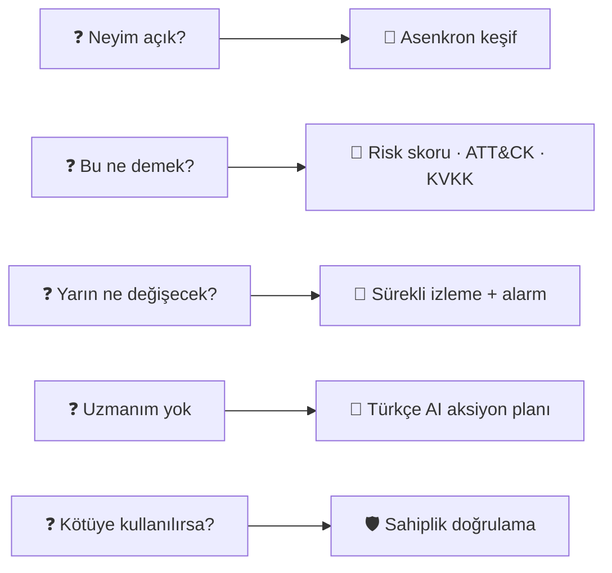

---

## 3. 💡 Çözüm ve kullanıcı yolculuğu

ReconClaw, bir alan adının dışarıdan görünen saldırı yüzeyini **keşiften aksiyon planına kadar** tek akışta ve Türkçe olarak sunar.

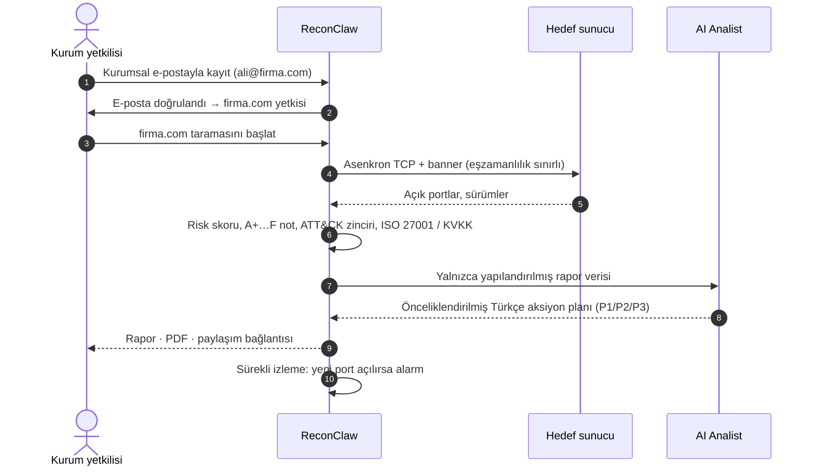

---

## 4. ✨ Özgün değer ve yenilikçi yönler

<table>
<tr>
<td width="50%" valign="top">

#### 🇹🇷 Uçtan uca Türkçe zincir
Keşif → risk skoru → ATT&CK saldırı zinciri → ISO 27001 / KVKK → önceliklendirilmiş aksiyon planı, **tek akışta ve tek raporda**.

</td>
<td width="50%" valign="top">

#### 🧮 Çift katmanlı deterministik analiz
Karne, ATT&CK ve uyum **testli kurallarla** hesaplanır. Yapay zekâ yalnızca bu sonuçları **yorumlar**; skor veya bulgu uyduramaz. İnternet yokken kural tabanlı analist devreye girer.

</td>
</tr>
<tr>
<td valign="top">

#### 💉 İstem enjeksiyonu farkındalığı
Banner ve HTTP başlıkları taranan, yani potansiyel olarak saldırgan kontrolündeki sunucudan gelir. Bu veriler modele **"güvenilmez veri"** olarak ayrı blokta verilir. LLM'li güvenlik araçlarında sık gözden kaçan bir saldırı yüzeyidir.

</td>
<td valign="top">

#### ⚖️ KVKK bağlamı
Teknik bulgular (ör. dışarıya açık veritabanı) doğrudan **KVKK m.12** veri güvenliği yükümlülüğüyle ilişkilendirilir.

</td>
</tr>
<tr>
<td valign="top">

#### 🛡️ Etik tasarım: "yalnızca kendi alan adın"
Tarama yetkisi **kanıta** bağlıdır: DNS TXT kaydı, doğrulama dosyası veya **doğrulanmış kurumsal e-posta**. Kamu, eğitim ve askeri alan adları e-postayla açılamaz.

</td>
<td valign="top">

#### 🛰️ Pasif keşif + sürekli izleme
Hedefe **tek paket göndermeden** Sertifika Şeffaflığı kayıtlarından alt alan adları ve SPF / DMARC / CAA durumu; zamanlanmış tarama ve fark analizi.

</td>
</tr>
</table>

---

## 5. 🏗️ Mimari

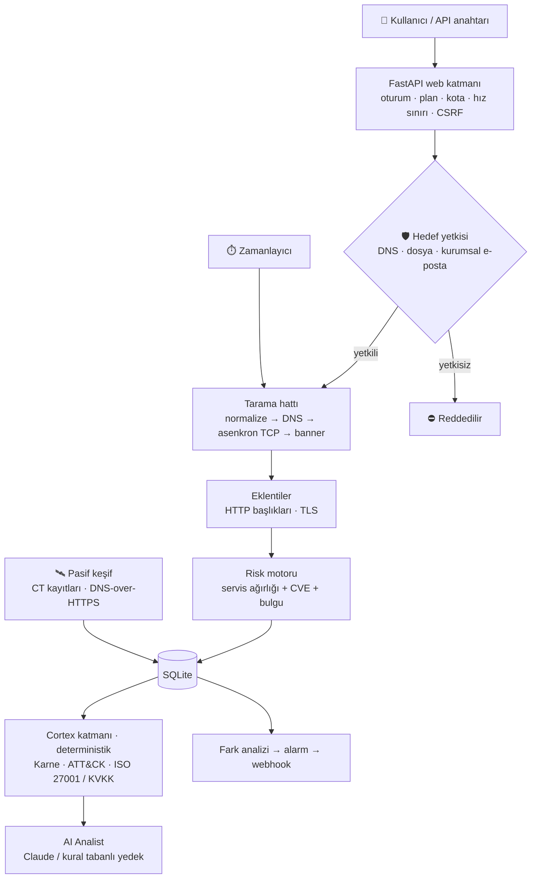

### Çift katmanlı deterministik analiz hattı

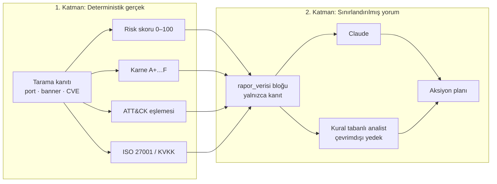

> Aynı girdi her zaman aynı skoru, notu ve ATT&CK zincirini üretir. Model **veride olmayan CVE, port veya sürüm yazmamakla** sınırlandırılmıştır.

---

## 6. 🖼️ Ekran görüntüleri

<table>
<tr>
<td width="50%">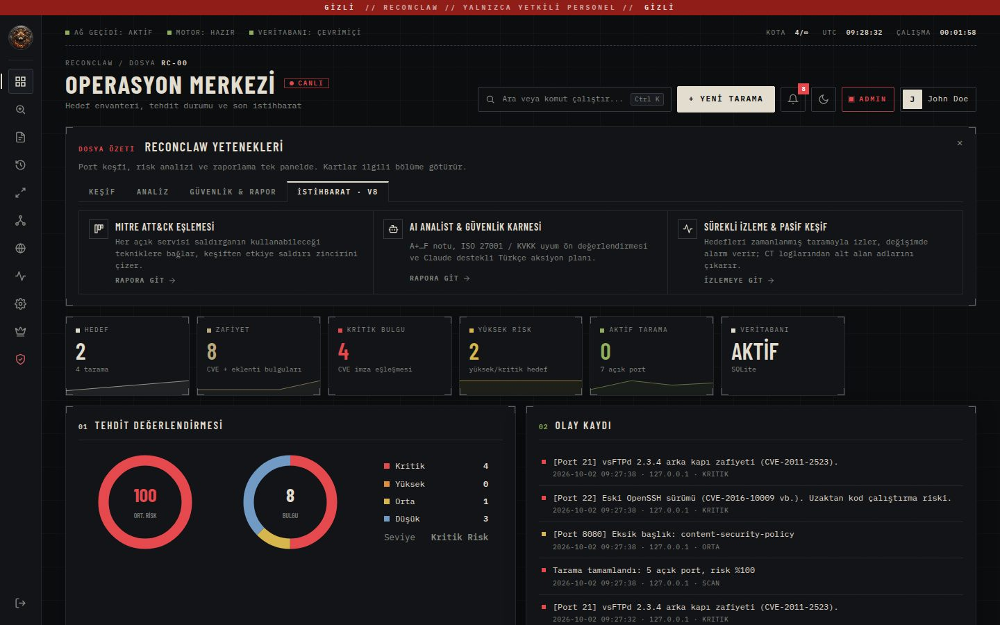</td>
<td width="50%">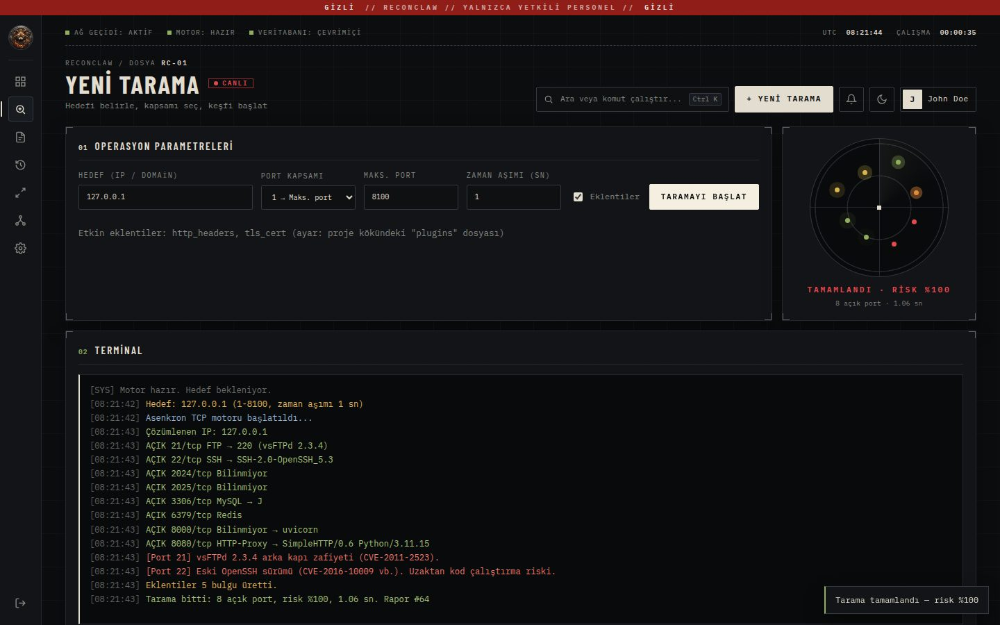</td>
</tr>
<tr>
<td align="center"><sub><b>Operasyon merkezi:</b> istatistikler, aktivite, son taramalar</sub></td>
<td align="center"><sub><b>Yeni tarama:</b> radar ve canlı terminal</sub></td>
</tr>
<tr>
<td>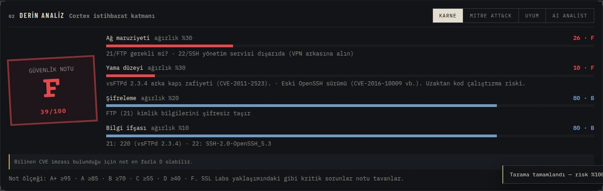</td>
<td>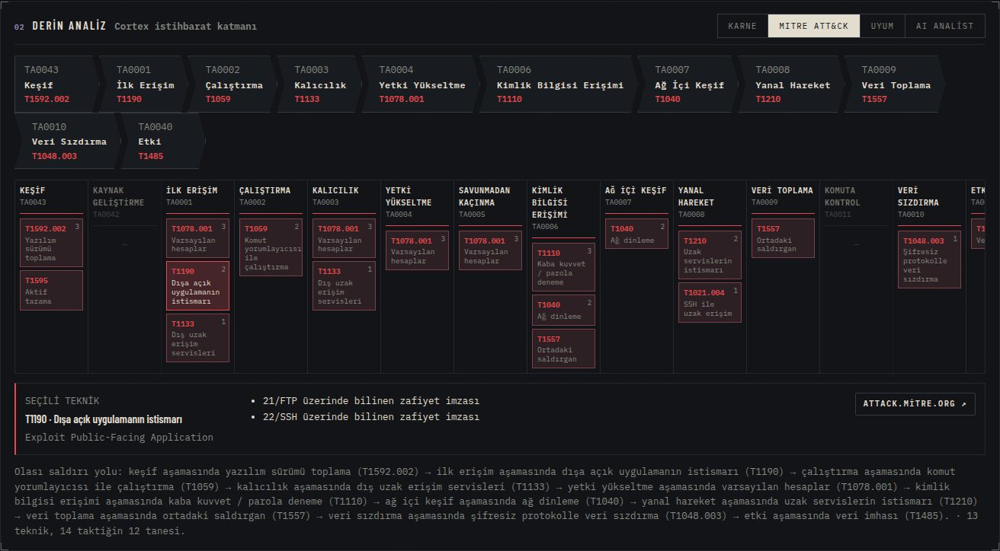</td>
</tr>
<tr>
<td align="center"><sub><b>Güvenlik karnesi:</b> 5 kategori, A+…F not ve not tavanı</sub></td>
<td align="center"><sub><b>MITRE ATT&CK:</b> teknik eşlemesi ve olası saldırı zinciri</sub></td>
</tr>
<tr>
<td>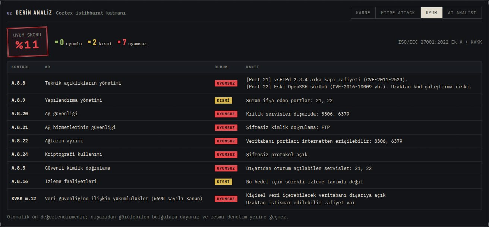</td>
<td>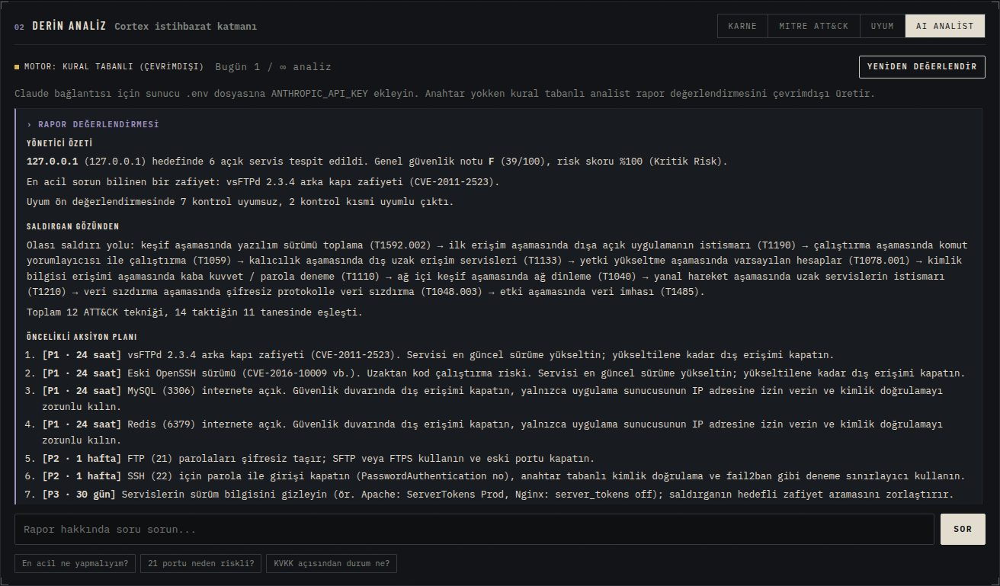</td>
</tr>
<tr>
<td align="center"><sub><b>Uyum:</b> ISO 27001 Ek A ve KVKK m.12 ön değerlendirmesi</sub></td>
<td align="center"><sub><b>AI Analist:</b> Türkçe, önceliklendirilmiş aksiyon planı</sub></td>
</tr>
<tr>
<td>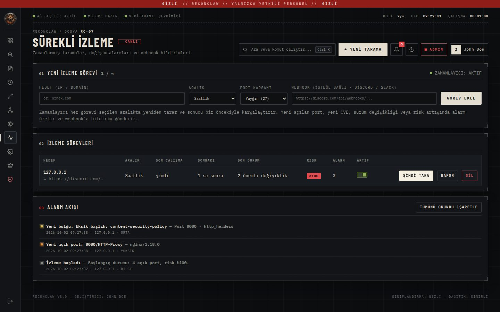</td>
<td>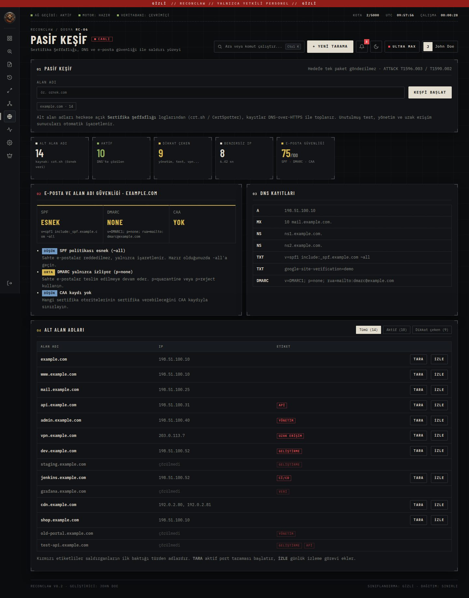</td>
</tr>
<tr>
<td align="center"><sub><b>Sürekli izleme:</b> zamanlanmış tarama ve alarmlar</sub></td>
<td align="center"><sub><b>Pasif keşif:</b> CT kayıtları, DNS, e-posta güvenliği</sub></td>
</tr>
<tr>
<td>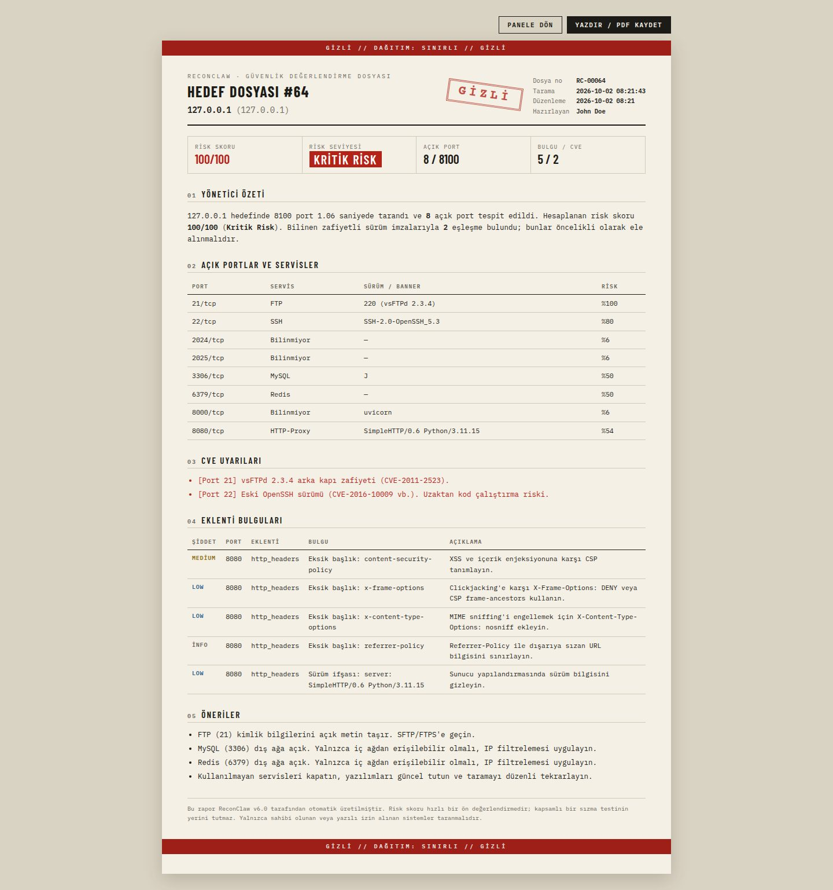</td>
<td>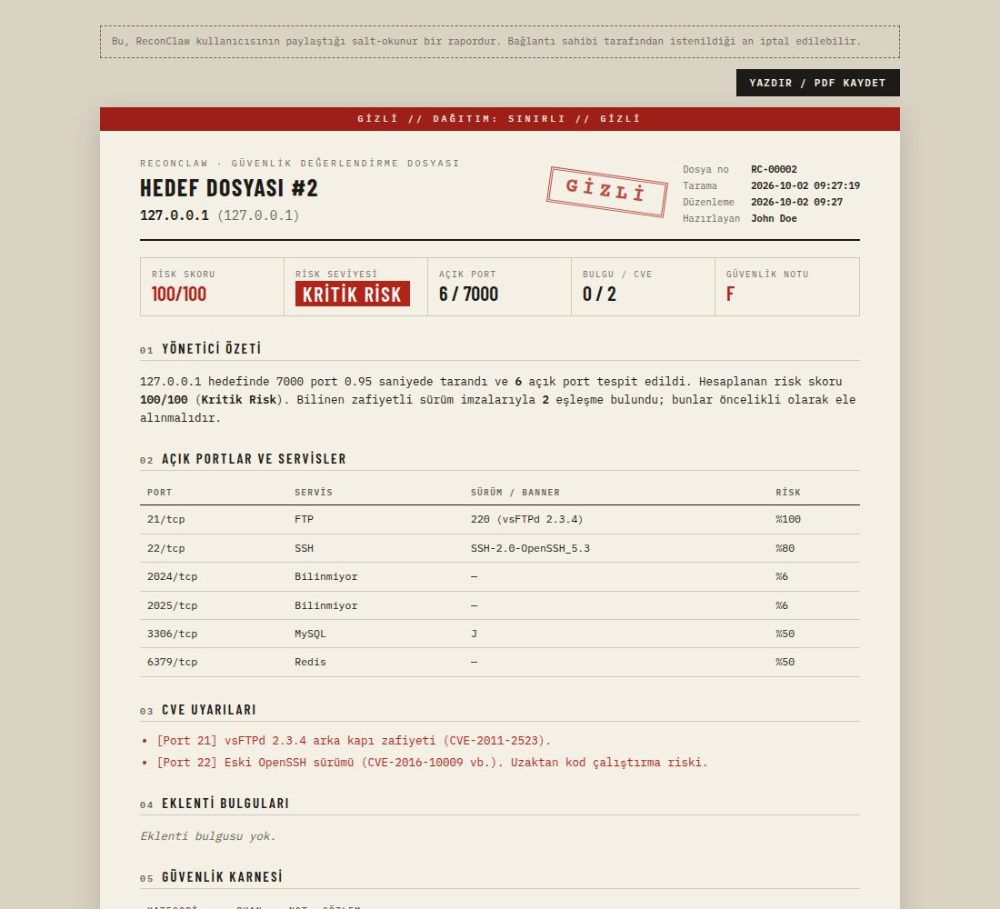</td>
</tr>
<tr>
<td align="center"><sub><b>PDF rapor:</b> yönetici özetli, yazdırılabilir</sub></td>
<td align="center"><sub><b>Paylaşım bağlantısı:</b> oturumsuz salt-okunur rapor</sub></td>
</tr>
</table>

<p align="center">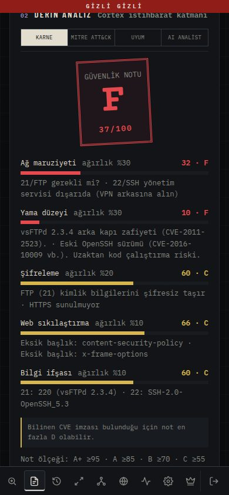 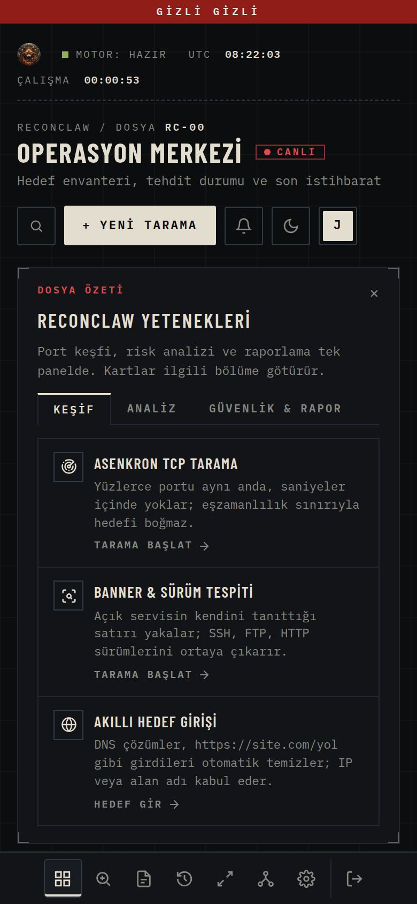</p>
<p align="center"><sub><b>Mobil uyumlu arayüz</b></sub></p>

---

## 7. 🔬 Yöntem

### 7.1 Tarama ve risk skoru

- Her port için `asyncio.open_connection` ile TCP bağlantısı denenir; bir **semafor** eşzamanlı bağlantıyı **300** ile sınırlar (hedefi boğmamak için).
- Açık portlardan ilk satır (HTTP'de `Server:` başlığı) okunur ve bilinen zafiyetli sürüm imzalarıyla eşleştirilir (vsFTPd 2.3.4, Apache 2.4.49/50, eski OpenSSH vb.).
- Hedef risk skoru:

$$\text{Risk} = \min\left(100,\ \sum_{\text{port}} \left(w_{\text{servis}} + w_{\text{CVE}} + w_{\text{bulgu}}\right)\right)$$

### 7.2 Güvenlik karnesi

| Kategori | Ağırlık | Ne ölçer? |
|----------|:-------:|-----------|
| 🌐 Ağ maruziyeti | %30 | Dışarıya açık kritik servisler |
| 🩹 Yama düzeyi | %30 | Bilinen zafiyetli sürümler |
| 🔐 Şifreleme | %20 | TLS ve şifresiz kimlik doğrulama |
| 🧱 Web sıkılaştırma | %10 | Güvenlik başlıkları (yalnızca web servisi varsa) |
| 📢 Bilgi ifşası | %10 | Sürüm ve sunucu bilgisi sızıntısı |

**Not eşikleri:** A+ ≥ 95 · A ≥ 85 · B ≥ 70 · C ≥ 55 · D ≥ 40 · F
**Not tavanı:** CVE eşleşmesi varken en fazla **D**; veritabanı / SMB / RDP / VNC dışarıya açıksa en fazla **C**. Böylece tek bir kritik açık, diğer iyi puanların arkasına saklanamaz.

### 7.3 MITRE ATT&CK eşlemesi

Port → teknik kural tablosu (ör. 22/SSH → T1133, T1110, T1021.004; 3306/MySQL → T1110, T1078.001, T1485) ve bulgu → teknik kuralları (CVE → T1190, T1059; TLS sorunları ve eksik HSTS → T1557). Teknikler **14 Enterprise taktiğine** dağıtılır; saldırı zinciri taktik sırasıyla, etkisi büyük teknikler öncelikli olacak şekilde kurulur.

### 7.4 Uyum ön değerlendirmesi

Dışarıdan gözlemlenebilen **8 ISO/IEC 27001:2022 Ek A** kontrolü (A.8.5, A.8.8, A.8.9, A.8.16, A.8.20, A.8.21, A.8.22, A.8.24) ve **KVKK m.12** için uyumlu / kısmi / uyumsuz kararı ve kanıtı üretilir. Çıktı resmi denetim yerine geçmez; denetime hazırlıkta yol gösterir.

### 7.5 AI Analist

Yapılandırılmış bağlam (portlar, banner'lar, CVE'ler, karne, ATT&CK zinciri, uyum) `<rapor_verisi>` bloğunda Claude'a gönderilir. Sistem talimatı; yalnızca veriye dayanmayı, veride olmayan CVE yazmamayı, savunma odaklı kalmayı ve bloktaki metinleri **talimat olarak uygulamamayı** şart koşar. Ağ veya anahtar sorunu olursa kural tabanlı analist aynı bölümleri üretir.

### 7.6 Sürekli izleme ve pasif keşif

Zamanlayıcı zamanı gelen görevleri aynı tarama hattından geçirir (kota ve yetki kuralları dahil), sonucu önceki taramayla karşılaştırır ve şiddet sınıflandırmasıyla alarm üretir; **yeni açılan veritabanı veya yönetim portu kritik** sayılır. Pasif keşif, Sertifika Şeffaflığı kayıtlarından alt alan adlarını toplar, DNS-over-HTTPS ile kayıtları alır ve SPF / DMARC / CAA politikalarını puanlar.

---

## 8. 🛡️ Etik ve güvenlik tasarımı

ReconClaw'ın en önemli tasarım ilkesi: **Herkes yalnızca kendi alan adını tarayabilir.**

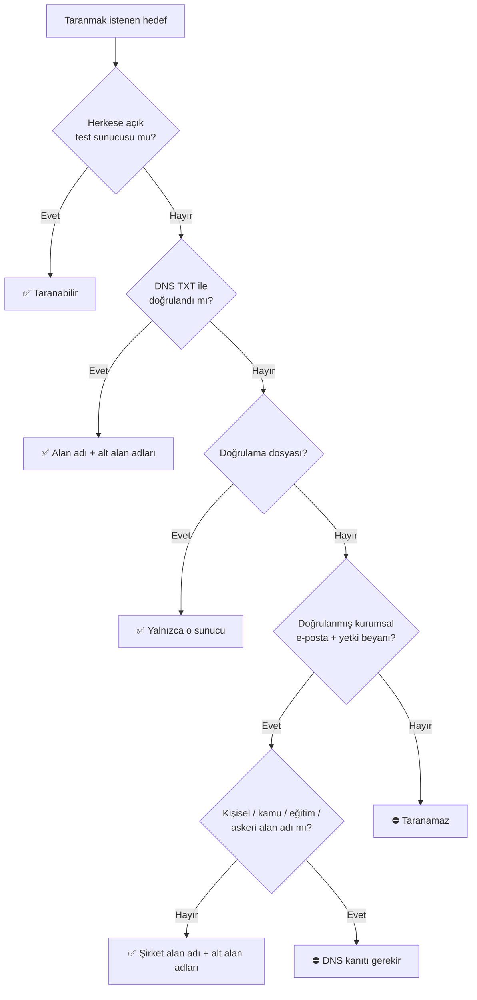

| Önlem | Ne sağlar? |
|-------|------------|
| 🔐 **Hedef sahipliği doğrulama** | DNS TXT, doğrulama dosyası veya doğrulanmış kurumsal e-posta olmadan tarama yapılamaz |
| 🏛️ **Kamu / eğitim / askeri koruması** | `gov`, `edu`, `mil`, `ac`, `k12` alan adları e-postayla açılamaz; bir çalışanın ya da öğrencinin kurumun tamamını taraması engellenir |
| 📧 **Kişisel e-posta koruması** | gmail, outlook gibi adresler alan adı yetkisi vermez |
| 🏠 **İç ağ engeli (SSRF)** | Sunucunun kendi iç ağı ve özel IP aralıkları taranamaz |
| ⏱️ **Kota ve hız sınırı** | Plan bazlı günlük / dakikalık sınırlar sunucu tarafında uygulanır |
| 📝 **Denetim kaydı** | Giriş, tarama yetkisi, rol ve ödeme işlemleri kayıt altındadır |
| 🤖 **Bot koruması** | Cloudflare Turnstile ve bal küpü alanı |
| 🔑 **Kimlik güvenliği** | Tuzlu scrypt parola; oturum ve API anahtarlarının yalnızca SHA-256 özeti saklanır; CSRF koruması |
| ⚖️ **Yasal sayfalar** | KVKK aydınlatma metni, gizlilik ve kullanım şartları sitede yayında |

> İzinsiz port taraması Türkiye'de **TCK 243–245** kapsamında suç teşkil edebilir. ReconClaw bu ilkeyi yalnızca uyarıyla değil, **teknik olarak** uygular.

---

## 9. ✅ Doğrulama ve testler

### 9.1 Otomatik testler (159)

```bash
pip install -r requirements.txt pytest
pytest            # 159 passed
```

| Alan | Test | Örnek kapsam |
|------|:----:|--------------|
| Yetki, oturum ve hesap güvenliği | 34 | Erişim kontrolü, CSRF, denetim kaydı |
| Tarama motoru ve risk modeli | 18 | Asenkron tarayıcı, banner, CVE imzaları |
| E-posta doğrulama | 14 | Kod, deneme sınırı, tek kullanım |
| Ödeme ve herkese açık sayfalar | 13 | İmzalı ödeme bildirimi, sitemap, yasal sayfalar |
| Planlar ve hedef doğrulama | 12 | Kota, port sınırı, açık test hedefleri |
| API ve kullanıcı izolasyonu | 11 | Başkasının taramasına erişememe |
| Cortex ve AI Analist | 11 | ATT&CK, karne, uyum, istem enjeksiyonu koruması |
| Kimlik doğrulama | 10 | scrypt, OAuth hesap bağlama |
| İzleme ve pasif keşif | 9 | Yeni port alarmı, SPF / DMARC / CAA |
| Bölgesel fiyat | 8 | Bölgenin yalnızca IP'den belirlenmesi |
| Eklentiler | 6 | HTTP başlık ve TLS denetimi |
| Kurumsal e-postayla alan adı | 5 | Kamu / kişisel alan adlarının reddi |
| İstatistik ve bot koruması | 8 | Panel, Turnstile, bal küpü |

### 9.2 Önerilen deneyler

> [!IMPORTANT]
> Aşağıdaki deneyler **henüz yapılmamıştır**. Ölçüp sonuç sütununu doldurun; ölçmediğiniz bir sonucu başvuruya yazmayın.

| Deney | Kurulum | Ölçülecek | Sonuç |
|-------|---------|-----------|:-----:|
| **D1** Port tespiti doğruluğu | VirtualBox: ReconClaw + Metasploitable 2, host-only ağ | `nmap -sT -p 1-1024` ile açık port örtüşmesi (kesinlik / duyarlılık) | *ölçülecek* |
| **D2** Hız | Aynı hedef, 1–1024 ve 1–10000 aralığı, 5'er tekrar | Ortalama süre, standart sapma, zaman aşımı etkisi | *ölçülecek* |
| **D3** Sürüm / CVE eşleşmesi | Metasploitable 2 (vsFTPd 2.3.4, eski OpenSSH) | Beklenen imzaların yakalanma oranı | *ölçülecek* |
| **D4** Değişim tespiti | İzleme görevi + hedefte yeni servis açma | Alarm üretim süresi | *ölçülecek* |
| **D5** AI tutarlılığı | Aynı rapor için 5 değerlendirme | P1 maddelerinin kural tabanlı analistle örtüşmesi; uydurma CVE var mı? | *ölçülecek* |

---

## 10. ⚖️ Mevcut çözümlerle karşılaştırma

ReconClaw mevcut araçların **yerini almayı değil**, onların çıktısını yorumlanabilir bir risk ve aksiyon katmanına dönüştürmeyi hedefler.

| Özellik | Nmap | Shodan | Ticari ASM ürünleri | **ReconClaw** |
|---------|:----:|:------:|:-------------------:|:-------------:|
| Port / servis tespiti | ✅ | ✅ *(pasif dizin)* | ✅ | ✅ |
| Web arayüzü, çok kullanıcı | — | ✅ | ✅ | ✅ |
| Risk skoru ve A+…F not | — | — | ✅ | ✅ |
| MITRE ATT&CK saldırı zinciri | — | — | Kısmen | ✅ |
| KVKK bağlamı | — | — | Genellikle yok | ✅ |
| Türkçe AI aksiyon planı | — | — | Genellikle yok | ✅ |
| Hedef sahipliği doğrulama | — | — | Değişken | ✅ |
| Açık kaynak, kendi sunucunda | ✅ | — | — | ✅ |

> Tablo genel nitelikleri özetler; ürünlerin sürüm ve paketlerine göre değişebilir. Jüriye sunmadan önce karşılaştırdığınız ürünlerin güncel özelliklerini kontrol edin.

---

## 11. 🌱 Yaygın etki ve yerlilik

| Kitle | Fayda |
|-------|-------|
| 🏢 **KOBİ'ler** | Uzman istihdam edemeyen şirketler dış saldırı yüzeyini Türkçe ve anlaşılır biçimde görür |
| 🎓 **Eğitim** | Siber güvenlik derslerinde ATT&CK, risk ve uyum kavramları somut çıktıyla öğretilir |
| 🏛️ **Kamu ve düzenleyici uyum** | KVKK m.12 ve ISO 27001 hazırlığında ön değerlendirme |
| 🧑‍💻 **Açık kaynak topluluğu** | Kural tabloları ve eklenti sistemi katkıya açık |

**Yerlilik:** Türkçe arayüz ve raporlama, KVKK odaklı uyum katmanı, Türkiye'de yerleşik ödeme altyapısıyla (PayTR) entegrasyon, yerli alan adında (.com.tr) yayın.

---

## 12. 💼 Sürdürülebilirlik ve iş modeli

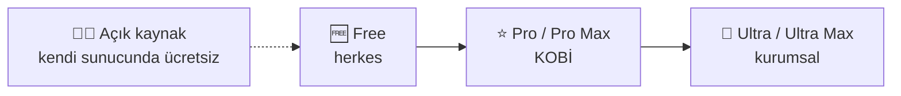

- **Ücretsiz plan** ve **açık kaynak kurulum** her zaman erişilebilir.
- Beş kademeli abonelik modeli ve PayTR ödeme altyapısı teknik olarak hazırdır.
- **Durum:** Canlı sitede ücretli satış, ilgili mevzuat kapsamında yetkili kurumdan beklenen **resmi görüş** tamamlanana kadar kapalıdır. Görüş olumsuz olursa ücretli planlar kaldırılacak; proje ücretsiz ve açık kaynak olarak sürecektir. Bu, ürünün yasal uyumu önceleyen yaklaşımının bir parçasıdır.

---

## 13. 🛣️ Yol haritası (v10.0 – v11.0)

> Aşağıdakiler **planlanan** güncellemelerdir; henüz geliştirilmemiştir. Ayrıntılar: [ana README → Yol Haritası](../../README.md#️-yol-haritası).

| Sürüm | Kod adı | Odak | Öne çıkanlar |
|:-----:|:-------:|------|--------------|
| v10.0 | 🏢 Bastion | Kurumsal hesaplar | Şirket çalışma alanı, şirket içi roller, iki adımlı doğrulama (TOTP) |
| v10.1 | 🎨 Prism | Tasarım ve erişilebilirlik | WCAG kontrast, yerel yazı tipleri, yeni vektör logo |
| v10.2 | 🧪 Forge | Güvenli yayın | Staging ortamı, testli otomatik yayın |
| v10.5 | 🔮 Oracle | Zafiyet zekâsı | NVD / OSV CVE veritabanı, EPSS ve CISA KEV önceliği |
| v11.0 | 🌍 Atlas | Ölçek ve entegrasyon | CIDR / UDP, Türkçe / İngilizce, SIEM, PostgreSQL |

---

## 14. 📅 İş-zaman planı ve risk yönetimi

### 14.1 İş-zaman planı (örnek; kendi takviminize göre düzenleyin)

| İş paketi | İçerik | Süre |
|-----------|--------|:----:|
| İP1 | Literatür ve mevcut araç incelemesi (Nmap, CT kayıtları, ATT&CK, ISO 27001, KVKK) | 1. ay |
| İP2 | Tarama motoru, risk modeli, web arayüzü | 2.–3. ay |
| İP3 | Çok kullanıcılı yapı, hedef doğrulama, güvenlik önlemleri | 4. ay |
| İP4 | Cortex katmanı: karne, ATT&CK, uyum | 5. ay |
| İP5 | AI Analist, sürekli izleme, pasif keşif, canlı yayın | 6. ay |
| İP6 | Deneyler (D1–D5), raporlama, sunum | 7.–8. ay |

### 14.2 Risk yönetimi (B planı)

| Risk | Olasılık | Önlem / B planı |
|------|:--------:|-----------------|
| Sunumda internet yok | Orta | Kural tabanlı analist; yerel laboratuvar hedefi; önceden hazırlanmış tarama ve keşif kayıtları |
| Claude API anahtarı / kota sorunu | Düşük | Otomatik kural tabanlı yedek, yanıt önbelleği |
| Hedef taramayı engeller (IDS / güvenlik duvarı) | Orta | Zaman aşımı ve port kapsamı ayarı; laboratuvar ortamı |
| Kötüye kullanım | Orta | Sahiplik doğrulama, iç ağ engeli, kota, denetim kaydı, hesap askıya alma |
| Yanlış pozitif CVE eşleşmesi | Orta | Dar ve sürüm bazlı imzalar; rapor "ön değerlendirme" olarak sunulur |
| Ücretlendirmeye yasal engel | Orta | Ücretsiz / açık kaynak modelle devam |

---

## 15. 💰 Bütçe şablonu

> Örnek kalemlerdir; **tutarları güncel fiyatlarla siz doldurun** ve programın bütçe kurallarına uyun.

| Kalem | Açıklama | Tutar |
|-------|----------|:-----:|
| Sunucu (VPS) | Canlı yayın için bulut sunucu, yıllık | *…* |
| Alan adı | reconclaw.com.tr yenileme, yıllık | *…* |
| Yapay zekâ API | AI Analist kullanım kredisi | *…* |
| Laboratuvar | Deneyler için sanal makine / donanım | *…* |
| Tanıtım | Poster, sunum materyali | *…* |
| **Toplam** | | *…* |

---

## 16. 🎙️ Jüri demo senaryosu (8 dakika)

| Süre | Adım | Ne söylenir? |
|:----:|------|--------------|
| 0:00 | **reconclaw.com.tr**'yi açın, giriş yapın | "Canlı, çok kullanıcılı, bot korumalı bir platform" |
| 0:45 | Abonelik → Doğrulanmış hedefler: açık test hedeflerini gösterin | "Herkes yalnızca kendi alan adını tarayabilir; kanıt olmadan tarama yok" |
| 1:30 | `scanme.nmap.org` taraması başlatın | "Asenkron motor, radarda canlı sonuç" |
| 2:30 | Hedef dosyası → **Karne** | "Bulgular A+…F nota dönüşüyor; CVE varsa not D'yi geçemiyor" |
| 3:30 | **MITRE ATT&CK** sekmesi | "Her açık port bir saldırı tekniğine bağlanıyor; olası saldırı zinciri" |
| 4:15 | **Uyum** sekmesi | "ISO 27001 ve KVKK m.12 ön değerlendirmesi, kanıtıyla" |
| 5:00 | **AI Analist** → değerlendirme | "Türkçe aksiyon planı; yapay zekâ uyduramaz, internet yoksa kural tabanlı analist" |
| 6:00 | **Sürekli izleme** + **Pasif keşif** | "Değişiklikte alarm; hedefe paket göndermeden alt alan adı keşfi" |
| 7:00 | **PAYLAŞ** → telefonda açın | "Jüri raporu oturum açmadan görüyor; tek tıkla iptal" |
| 7:30 | Etik tasarım akış şemasını gösterin | "Güvenlik aracı da güvenli ve etik tasarlanmalı" |

### Sunumdan önce kontrol listesi

- [ ] Canlı site açılıyor; yedek olarak yerel kurulum (`python main.py`) hazır
- [ ] Demo hesabı ve en az bir tarama, izleme görevi (alarmlı) ve pasif keşif kaydı önceden hazır
- [ ] İnternetsiz senaryo için yerel laboratuvar hedefi (ör. Metasploitable 2) açık
- [ ] Bir AI değerlendirmesi önceden üretilmiş (önbellekten anında açılır)
- [ ] Paylaşım bağlantısı telefonda açılıyor
- [ ] Tarayıcı önbelleği temiz (**Ctrl+Shift+R**), tam ekran, yakınlaştırma %100

---

## 17. ❓ Jüriden beklenebilecek sorular

<details>
<summary><b>Nmap / Shodan'dan farkı ne?</b></summary>

Onların yerini almaz. Tespitin üzerine risk skoru, ATT&CK saldırı zinciri, ISO 27001 / KVKK değerlendirmesi, Türkçe AI aksiyon planı, sürekli izleme ve çok kullanıcılı raporlama katmanı ekler.
</details>

<details>
<summary><b>Yapay zekâ yanlış bilgi verirse?</b></summary>

Skor, not, ATT&CK ve uyum deterministik ve testli kurallarla hesaplanır; model yalnızca yorumlar ve veride olmayan CVE yazmamakla sınırlandırılmıştır. Model devre dışıyken de sistem kural tabanlı analistle çalışır.
</details>

<details>
<summary><b>Taranan sunucu banner'ına kötü niyetli talimat yazarsa?</b></summary>

Banner'lar modele ayrı veri bloğunda "güvenilmez veri" olarak verilir; sistem talimatı bu metinlerin talimat olarak uygulanmasını yasaklar (istem enjeksiyonu önlemi) ve bu davranış otomatik testle doğrulanır.
</details>

<details>
<summary><b>Kötüye kullanımı nasıl önlüyorsunuz?</b></summary>

Tarama yetkisi kanıta bağlıdır: DNS TXT, doğrulama dosyası veya doğrulanmış kurumsal e-posta. Kişisel e-postalar ve kamu / eğitim / askeri alan adları e-postayla açılamaz. Ayrıca iç ağ engeli, kota, hız sınırı, denetim kaydı ve hesap askıya alma vardır.
</details>

<details>
<summary><b>Uyum çıktısı resmi bir denetim mi?</b></summary>

Hayır. Dışarıdan gözlemlenebilen bulgulara dayalı ön değerlendirmedir; denetime hazırlıkta yol gösterir.
</details>

<details>
<summary><b>Ölçeklenebilir mi?</b></summary>

Tarama asenkron ve eşzamanlılığı sınırlıdır. Veritabanı katmanı SQLite ile başlar; PostgreSQL desteği yol haritasındadır. Docker, Caddy ve Cloudflare ile canlı yayındadır; her birleştirmede otomatik yayın yapılır.
</details>

<details>
<summary><b>Ticari model yasal mı?</b></summary>

Ücretli satış, ilgili mevzuat kapsamında yetkili kurumdan beklenen resmi görüşe kadar kapalı tutulmaktadır. Yasal uyum ticari gelirden önce gelir; gerekirse ürün ücretsiz ve açık kaynak olarak sürer.
</details>

---

## 18. 👥 Takım

> Başvuru formuna göre doldurun.

| Rol | Ad Soyad | Sorumluluk |
|-----|----------|------------|
| Takım kaptanı | *…* | Proje yönetimi, mimari, tarama motoru |
| Üye | *…* | *…* |
| Üye | *…* | *…* |
| Danışman | *…* | *…* |

---

## 19. 📚 Kaynakça

1. MITRE ATT&CK® Enterprise Matrix. https://attack.mitre.org
2. ISO/IEC 27001:2022, *Information security, cybersecurity and privacy protection — Information security management systems — Requirements*, Ek A.
3. 6698 sayılı Kişisel Verilerin Korunması Kanunu, m.12 (Veri güvenliğine ilişkin yükümlülükler). https://www.mevzuat.gov.tr
4. 5237 sayılı Türk Ceza Kanunu, m.243–245 (Bilişim alanında suçlar).
5. RFC 6962, *Certificate Transparency*. IETF.
6. RFC 9116, *A File Format to Aid in Security Vulnerability Disclosure (security.txt)*. IETF.
7. OWASP Secure Headers Project. https://owasp.org/www-project-secure-headers/
8. OWASP Top 10 for Large Language Model Applications (LLM01: Prompt Injection). https://owasp.org
9. Nmap Reference Guide. https://nmap.org/book/man.html

---

## 20. 🌍 English summary

**ReconClaw** is a web-based, multi-user attack surface management platform, live at [reconclaw.com.tr](https://reconclaw.com.tr) and fully open source. It discovers exposed services with an asynchronous TCP scanner, fingerprints versions from banners and matches them against known-vulnerable signatures, then turns the findings into a 0–100 risk score and an A+…F security grade. Each finding is mapped to MITRE ATT&CK techniques to derive a plausible kill chain, assessed against ISO/IEC 27001:2022 Annex A and the Turkish Personal Data Protection Law (KVKK, Art. 12), and summarised by an AI analyst (Claude, with a deterministic offline fallback) into a prioritised remediation plan in Turkish. A double-layer design keeps all scoring deterministic and tested, while the language model only interprets bounded scan evidence and treats scanned banners as untrusted data. Scanning is authorised only for proven targets (DNS TXT, a verification file, or a verified corporate email; public-sector, education and military domains always require DNS proof). The project is validated by 159 automated tests.

---

<p align="center">
<br>
<sub>🦝 Maskeli gözlerle keşfeder, pençesiyle açıkları yakalar.</sub><br>
<sub><a href="../../README.md">← Ana README'ye dön</a></sub>
</p>
